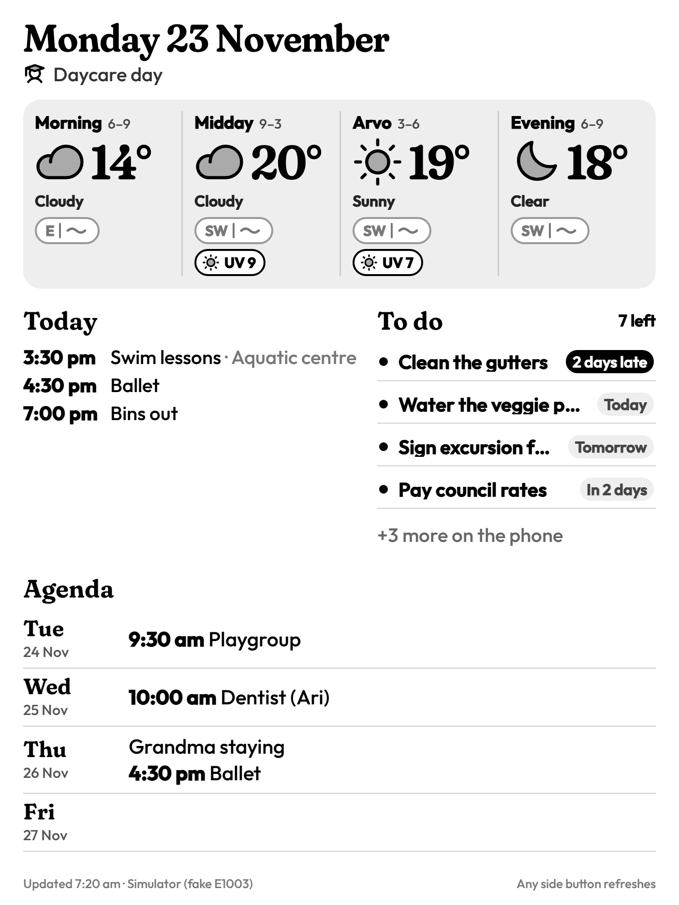
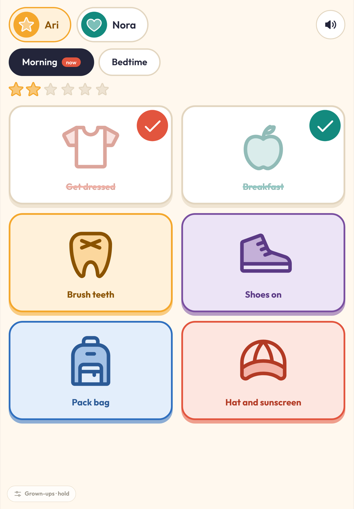
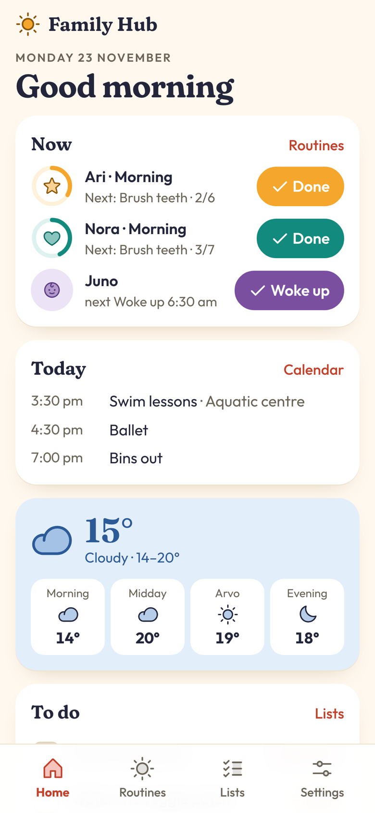
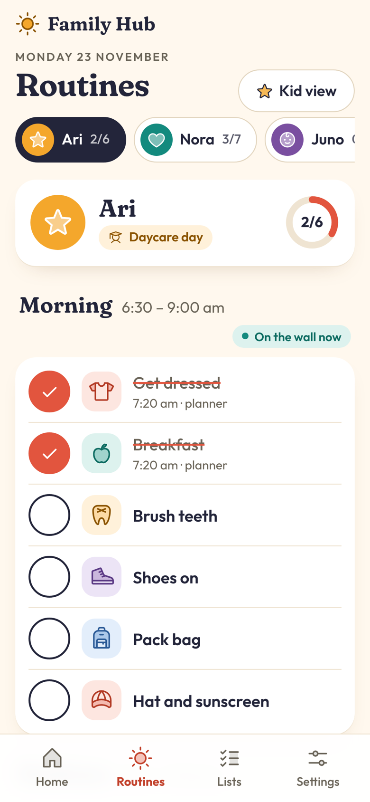
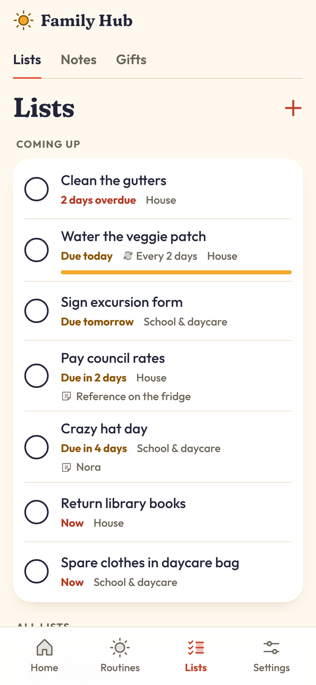
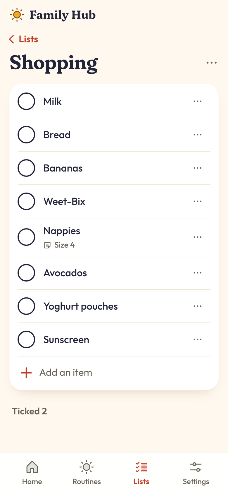

# Family Hub

A calm, self-hosted family planner built around an e-paper wall display. It is a small
SvelteKit + SQLite app that drives a Seeed reTerminal E1003 (10.3" 16-grey e-paper) through
[Tesserae](https://tesserae.ink), with a phone app for the adults and a big-button routine view
for the kids. No cloud, no subscription.

<p align="center">
  
  &nbsp;
  
</p>
<p align="center"><em>The wall as Tesserae renders it (1404×1872), and the kid view on an iPad.</em></p>

<p align="center">
  
  
  
  
</p>
<p align="center"><em>The Planner, an installable PWA for adults. Screenshots use made-up demo data.</em></p>

## What it does

- **Wall** (e-paper): the date and day type, weather in four blocks (morning, midday, arvo,
  evening), today's calendar, urgent to-dos, and the coming week. Read-only; the side buttons
  refresh it, and it repaints within seconds of a change made on a phone.
- **Kid view** (any tablet): each child's morning and bedtime routine as large picture cards.
  Tap to tick, hold to undo, with sounds; a grown-up holds a button to leave.
- **Planner** (phones, PWA): routines with day types (daycare, home, swimming…) that change
  which steps appear, a baby's day plan with nap timers, shared lists with due dates and
  repeats, notes, a gift tracker, and the family calendar.
- **Board** (any spare screen): a browser view of the same day, paired once per browser.
- **Calendar**: read from the ICS feeds Tesserae already downloads. An event titled with a
  day type ("Daycare", "Ari: Home") sets that day for the family or one child.

## Status

Pre-1.0 and in daily use by one household. It was built for that household, so a few things
are assumptions rather than settings: routines run on `Australia/Perth` time, the wall layout
targets the E1003, and the Planner has one shared PIN (no per-adult accounts yet). The
[roadmap](docs/roadmap.md) says what is done and what is next. Issues and pull requests are
welcome; see [CONTRIBUTING.md](CONTRIBUTING.md).

## Run it

**Just want a look?** `npm install && npm run demo` starts a made-up household with no Docker
and no display; see [docs/getting-started.md](docs/getting-started.md).

For the real thing you need Docker (multi-arch images: arm64 and amd64). The E1003 is optional: the built-in
simulator shows exactly what Tesserae would send it.

```sh
cp .env.example .env     # set ADMIN_PIN, TESSERAE_SECRET_KEY, TESSERAE_ADMIN_PASSWORD,
                         # TESSERAE_PUSH_TOKEN, HOST_LAN_IP
docker compose up -d     # app on :3000, Tesserae on :8765
```

On first start the app seeds a demo household (one child, morning and bedtime routines, three
day types) and sets up Tesserae itself: admin password, timezone, tokens, the `family_hub`
widget, a simulated E1003 and its wall page. Watch `docker compose logs family-hub` for
`[tesserae] wall page for sim-wall`.

- Planner: http://localhost:3000/planner (PIN = `ADMIN_PIN`). Phones on the LAN use the host's IP.
- Kid view: Planner → Routines → **Kid view** (or `/planner/kids`).
- Simulator: http://localhost:3000/sim. **Glass** shows what Tesserae sent the simulated
  device; **Direct** runs the same painter without Tesserae.
- Tesserae: http://localhost:8765 (password = `TESSERAE_ADMIN_PASSWORD`). Add calendar feeds
  and a weather location here and in Planner → Settings.

Pairing a real E1003 is in [docs/hardware-setup.md](docs/hardware-setup.md). For an
always-on install see [docs/unraid.md](docs/unraid.md) (one example deployment), and
[docs/remote-access.md](docs/remote-access.md) for reaching the Planner away from home.

### Development

```sh
npm install              # Node 22
docker compose up -d tesserae
npm run dev -- --host    # .env is loaded; set TESSERAE_URL=http://localhost:8765 and
                         # APP_BASE_URL_FOR_TESSERAE=http://host.docker.internal:5173
npm test                 # unit + integration (Vitest)
npm run check            # svelte-check, strict TypeScript
npm run build && npm run test:e2e   # Playwright; E2E_TESSERAE=1 to go through Tesserae
npm run db:generate      # new Drizzle migration after editing src/lib/server/db/schema.ts
npx tsx tesserae/scripts/build-page.ts   # regenerate tesserae/pages/wall.json after painter/layout edits
```

## Layout

```
src/lib/server/db/          schema.ts (Drizzle), migrations in drizzle/
src/lib/server/domain/      routines, day types, lists, calendar, wall render payload, toggles
src/lib/server/tesserae/    client, page builder, widget packager, bootstrap, repaint rule
src/lib/server/sim/         fake always-on E1003 (framebuffer + PNG)
src/routes/api/             render JSON, button webhooks, SSE events; /healthz
src/routes/planner/         Planner PWA (Home, Routines, Lists, Settings, kid view)
src/routes/board/           Board
src/routes/sim/             simulator
tesserae/widget/family_hub/ Tesserae widget (data source)
tesserae/paint/             wall painter + glyphs (shared by Tesserae and /sim)
tesserae/pages/             layout.json (geometry) and wall.json (page definition)
tests/                      unit, integration, e2e
spikes/                     early evidence scripts against Tesserae (not part of the app)
docs/                       spec, architecture and decision records, roadmap, testing, hardware
```

## Read next

| File | What it is |
|---|---|
| [docs/getting-started.md](docs/getting-started.md) | Demo, Docker setup, real display |
| [docs/architecture.md](docs/architecture.md) | How it works, decision records (ADRs), spike results |
| [docs/roadmap.md](docs/roadmap.md) | What is done and what is next |
| [docs/testing.md](docs/testing.md) | Tests, simulator, measured latency, hardware checklist |
| [docs/hardware-setup.md](docs/hardware-setup.md) | Flashing, pairing and wiring the E1003 |
| [docs/SPEC.md](docs/SPEC.md) | The original spec (historical; ADRs win) |
| [docs/skylight-parity.md](docs/skylight-parity.md) | Feature triage against a commercial family calendar |
| [AGENTS.md](AGENTS.md) | Working agreement for contributors and coding agents |

## Licence

GNU Affero General Public License v3.0 or later, see [LICENSE](LICENSE). You can use, change
and self-host it freely; if you run a modified version that others use over a network, you must
offer them its source. Tesserae is a separate project with its own licence and is pulled as a
container image, not included here.
